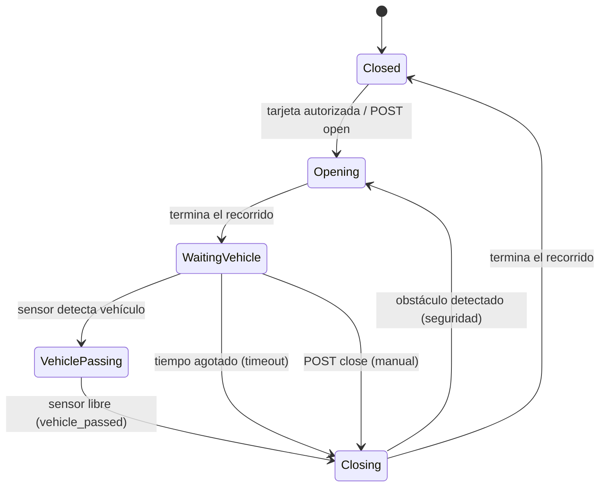

# Módulo Caseta (acceso con RFID)

Barra de acceso controlada con tarjeta RFID. Abre al leer una tarjeta autorizada,
espera a que el vehículo pase (HC-SR04) y cierra sola. Cada intento queda en una
bitácora.

## Hardware

| Componente | Pines ESP32 | Notas |
|---|---|---|
| RC522 | SCK 18, MISO 19, MOSI 23, SS 5, RST 27 | **3.3 V**, nunca 5 V |
| Servo | GPIO 13 | Alimentación 5 V externa, GND común con el ESP32 |
| HC-SR04 | TRIG 25, ECHO 34 | ECHO sale a 5 V: **divisor de voltaje** (1 kΩ + 2 kΩ) |
| Buzzer pasivo | GPIO 33 | Sonidos de acceso / denegado / cierre |

## Máquina de estados



Una segunda tarjeta válida mientras está abierta **extiende** la espera.
La lógica está en `lib/GateLogic` (C++ puro) y se prueba con `pio test -e native`
(17 pruebas, incluye el desbordamiento de `millis()`).

## Tarjetas autorizadas

Se guardan en la memoria NVS del ESP32 (sobreviven a reinicios y a re-subir el
firmware). Máximo 32.

1. `POST /api/gate/learn` abre una ventana de 20 s.
2. Acerca la tarjeta nueva: queda registrada (`result: learned`).
3. Revisa con `GET /api/gate/cards`.

## Calibración del sensor

1. Abre el monitor serie y consulta `GET /api/status`: el campo `distance_cm` muestra la lectura.
2. Mide la distancia con la vía libre y con un vehículo (o una caja) pasando.
3. Ajusta en `include/config.h`: `GATE_DETECT_CM` debe quedar bien por debajo de la
   lectura "libre" (el margen de liberación es `GATE_RELEASE_MARGIN_CM`).
4. `distance_cm = -1` significa "sin eco": superficies muy inclinadas o suaves
   pueden devolver el sonido fuera del sensor y parecer "vía libre".

## Pruebas desde PowerShell

```powershell
$t = "TU_API_TOKEN"
curl.exe -X POST -H "X-API-Token: $t" http://192.168.4.1/api/gate/learn
curl.exe -H "X-API-Token: $t" http://192.168.4.1/api/gate/cards
curl.exe -X POST -H "X-API-Token: $t" http://192.168.4.1/api/gate/open
curl.exe -H "X-API-Token: $t" "http://192.168.4.1/api/gate/log?limit=10"
```

## Limitaciones conocidas

- La bitácora del ESP32 guarda las últimas 50 entradas en RAM y usa *uptime*, no
  hora real; el backend asigna la fecha al recibir cada evento (`seq` evita duplicados).
- Un solo sensor ultrasónico: no distingue un vehículo de otro objeto.
