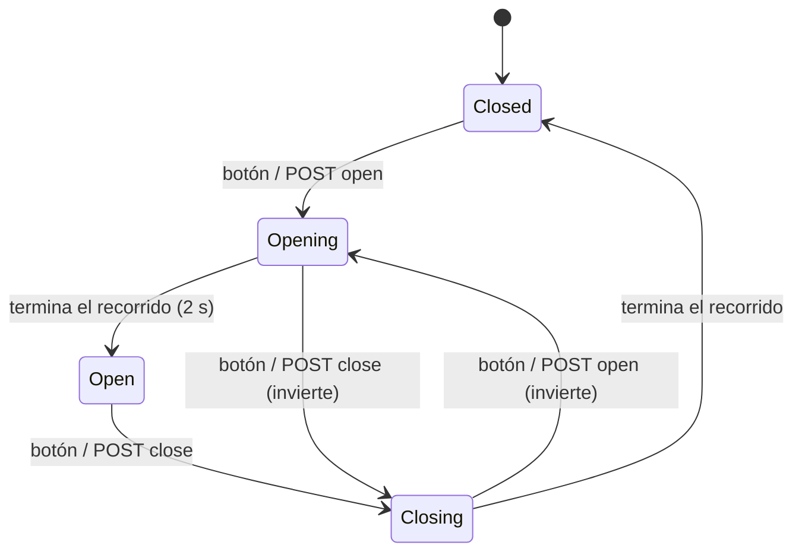

# Módulo Cochera (portón de una hoja)

Portón batiente de una sola hoja con un servo en la bisagra. Se abre y cierra
con un control remoto de 433 MHz (receptor RX480E + control Sonoff) o por la API.
Un **solo botón** del control alterna: si está cerrado abre, si está abierto cierra.

## Hardware

| Componente | Pin ESP32 | Notas |
|---|---|---|
| Servo de la hoja | GPIO 14 | 5 V externa, GND común con el ESP32 |
| RX480E D0 (botón A, alterna) | GPIO 36 | Salida de 5 V: **divisor de voltaje** (1 kΩ + 2 kΩ); solo entrada |
| RX480E D1 (botón B, alterna, opcional) | GPIO 39 | Igual que D0; solo se usa si aprendes un segundo botón |

- La hoja gira de 0° (cerrado) a 90° (abierto) en los valores iniciales. Se calibran por
  API sin volver a subir el firmware; si gira al lado contrario, intercambia los valores.
- Un capacitor de 470–1000 µF cerca de la alimentación de los servos evita reinicios
  por caídas de voltaje.

## Cómo funciona



- El movimiento es gradual: la posición avanza con el tiempo (2 s de recorrido) y el
  servo sigue esa posición entre los ángulos de cerrado y abierto.
- Con el botón, cada pulsación alterna: cerrado o cerrando → abre; abierto o abriendo → cierra.
- Una orden contraria a mitad del recorrido invierte desde donde está, sin saltos.
- Una orden repetida (abrir cuando ya está abriendo o abierto) se ignora.
- **Control remoto en modo anclaje:** cada pulsación cambia la salida del receptor entre
  0 y 1. El firmware detecta ese **cambio de nivel** (en cualquier sentido) y alterna. Así
  no importa si el portón se movió por la API: una pulsación siempre lo invierte.
- Antirrebote: el cambio debe mantenerse 50 ms y hay 400 ms de tiempo muerto entre
  pulsaciones (una pulsación muy rápida se aplica al vencer ese tiempo). El nivel que
  tenga el receptor al encender el ESP32 es solo la referencia y no cuenta como pulsación.
- No cierra solo: no hay sensor de obstáculos en el portón.

## Calibración

Con la laptop en la red del ESP32:

```powershell
$t = "dbsystems"
curl.exe -X POST -H "X-API-Token: $t" "http://192.168.4.1/api/garage/open"
curl.exe -X POST -H "X-API-Token: $t" "http://192.168.4.1/api/garage/close"
# Ajustar los ángulos (se guardan en la memoria del ESP32)
curl.exe -X POST -H "X-API-Token: $t" "http://192.168.4.1/api/garage/servo?closed=0&open=90"
```

Pasos:
1. Con el portón **cerrado**, ajusta `closed` hasta que la hoja quede a ras del marco.
2. Abre y ajusta `open` hasta el ángulo de apertura que quieras.
3. Si la hoja se mueve al lado contrario, intercambia los valores `closed` y `open`.
4. Si la hoja choca al cerrar, acorta el recorrido (acerca `closed` a `open`).

## Receptor RX480E y control

El receptor (RX480-E4) guarda el control por aprendizaje y tiene varios modos. Para este
portón se usa el **modo anclaje**: cada pulsación del botón cambia la salida entre
0 y 1 y la mantiene. El firmware reacciona a cada cambio y alterna abrir y cerrar.

Programar el botón:
1. Desprograma lo anterior: pulsa el botón del módulo **8 veces** y espera a que parpadee el LED.
2. Pulsa el botón del módulo **2 veces** (modo anclaje; el LED se enciende).
3. Pulsa el botón del control que quieras usar (el LED del módulo parpadea al aprenderlo).

Qué salida cambia cada botón: el botón A del control activa D0, el B activa D1, el C activa D2
y el D activa D3. El firmware escucha **D0 y D1** (botones A y B); un botón C o D no funciona
porque no hay pines libres para D2 y D3.

- No uses el modo momentáneo con este firmware: cada pulsación daría dos cambios (al
  presionar y al soltar) y alternaría dos veces.
- Alimenta el RX480E a 5 V y conecta la antena.
- Las salidas son de 5 V: sin divisor puedes dañar el ESP32.
- Para ver si llega la señal, mira en el monitor serial `control remoto: abrir` o
  `control remoto: cerrar`.

## Pruebas unitarias

`test/test_logic` cubre el recorrido y la inversión, la interpolación de ángulos en
ambos sentidos, el desbordamiento de `millis()` y el antirrebote y la detección de cambios del control. En la
PC: `pio test -e native`.
