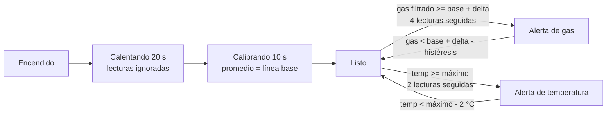

# Módulo Cocina (temperatura y gas)

Vigila la cocina con un KY-015 (sensor DHT11: temperatura y humedad) y un MQ-2 (gas/humo). Si la
temperatura es alta **o** se detecta gas, parpadea el LED rojo (GPIO 22) y suena la
alarma en el buzzer. Todo es no bloqueante y la decisión de alertar está en
`lib/KitchenLogic`, una clase pura con pruebas unitarias.

## Hardware

| Componente | Pin ESP32 | Alimentación | Notas |
|---|---|---|---|
| KY-015 (S, señal) | GPIO 4 | 3.3 V | Módulo de 3 pines (S, centro = VCC, -); ya trae su pull-up |
| MQ-2 (AO) | GPIO 32 (ADC1) | 5 V | La salida AO puede llegar a 5 V: **divisor de voltaje** (p. ej. 1 kΩ + 2 kΩ) |
| LED de alerta | GPIO 22 | — | Con resistencia de 220–330 Ω a GND |
| Buzzer | GPIO 33 | — | El mismo de la caseta |

> El KY-015 usa un DHT11: mide 0–50 °C con ±2 °C de precisión y resolución de 1 °C,
> suficiente para alertar a 40 °C. Si cambias por un DHT22, cambia `DHT11` por `DHT22` en `KitchenModule.cpp`.

> El MQ-2 se calienta (consume ~150 mA) y necesita unos minutos encendido para
> estabilizarse. Es normal que las primeras lecturas sean más altas.

## Cómo decide



- **Línea base:** el MQ-2 cambia con la temperatura, la humedad y el tiempo, así que
  no se usa un valor fijo. Tras el calentamiento se promedia el aire "normal" y se
  alerta cuando sube `gas_delta` cuentas sobre ese promedio. **Arranca el equipo con
  aire limpio** (sin humo ni gas cerca).
- **Histéresis y confirmación:** evitan que un pico aislado dispare la alarma y que
  la alerta parpadee cuando el valor oscila cerca del umbral.
- **Sensor de temperatura fallido:** una lectura mala no cambia el estado; tras 5 seguidas,
  `dht_ok` pasa a `false`.
- **Buzzer compartido:** si la caseta emite un sonido mientras suena la alarma, la
  alarma se retoma sola al terminar.

## Valores iniciales (`include/config.h`)

| Constante | Valor | Significado |
|---|---|---|
| `KITCHEN_TEMP_MAX_C` | 40 °C | Alerta de temperatura |
| `KITCHEN_TEMP_HYST_C` | 2 °C | Se despeja por debajo de 38 °C |
| `KITCHEN_GAS_DELTA` | 450 | Cuentas ADC sobre la línea base |
| `KITCHEN_GAS_HYST` | 100 | Histéresis del gas |
| `KITCHEN_WARMUP_MS` | 20 000 | Calentamiento |
| `KITCHEN_BASELINE_MS` | 10 000 | Ventana de la línea base |

## Calibración y pruebas

1. Enciende con aire limpio y espera ~30 s: `GET /api/status` debe mostrar
   `phase: "ready"` y un `gas_baseline`.
2. **Gas:** acerca (sin tocar) un encendedor de gas **sin encenderlo** o alcohol en
   un algodón al MQ-2. `gas_filtered` debe subir y, al pasar `gas_threshold`, activarse
   `gas_alert`. Si es muy sensible o muy duro, ajusta `gas_delta`.
3. **Temperatura:** baja el máximo para probar sin calentar nada
   (`temp_max` justo por encima de la temperatura ambiente) y sostén el sensor entre los dedos.
4. Restaura los valores reales al terminar.

```powershell
# Ajustar umbrales (se guardan en la memoria del ESP32)
curl.exe -X POST -H "X-API-Token: dbsystems" "http://192.168.4.1/api/kitchen/config?temp_max=30&gas_delta=300"
# Silenciar el buzzer de la alerta en curso
curl.exe -X POST -H "X-API-Token: dbsystems" http://192.168.4.1/api/kitchen/silence
# Volver a medir la línea base (con aire limpio)
curl.exe -X POST -H "X-API-Token: dbsystems" http://192.168.4.1/api/kitchen/calibrate
```

## Pruebas unitarias

`test/test_logic` cubre: calentamiento ignorado, promedio de la línea base, alerta
con confirmación e histéresis, pico aislado, temperatura, lecturas fallidas,
recalibración y desbordamiento de `millis()`. En la PC: `pio test -e native`.
