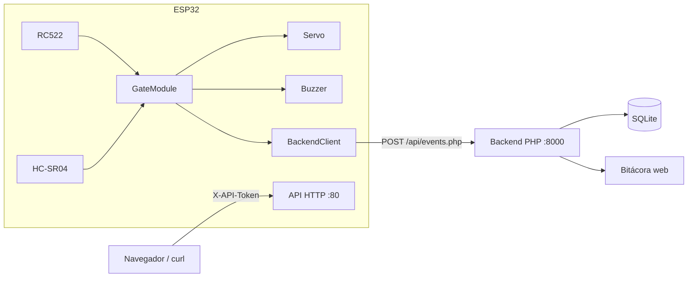

# Puesta en marcha

Guía para dejar todo funcionando desde cero y para volver a encenderlo en cada sesión.

## Arquitectura



El ESP32 abre su propia red (AP) y además se une a otra red (STA). El backend corre en la
laptop y debe estar en la **misma red** que el ESP32 para que este pueda enviarle eventos.

## Una sola vez

1. **PHP 8.1 o superior** con `pdo_sqlite`: `php -v` y `php -m | findstr sqlite`.
2. **Backend:** en `backend/`, `copy config.example.php config.php` y pon en `api_token` el
   mismo valor que `API_TOKEN` del firmware.
3. **Firewall** (PowerShell como administrador):
   ```powershell
   New-NetFirewallRule -DisplayName "Smart Home backend" -Direction Inbound -Protocol TCP -LocalPort 8000 -Action Allow -Profile Any
   ```
4. **Credenciales:** copia `include/secrets.h.example` como `include/secrets.h` y completa
   `AP_SSID`, `AP_PASS`, `WIFI_STA_SSID`, `WIFI_STA_PASS`, `API_TOKEN` y `BACKEND_URL`.
   `secrets.h` está en `.gitignore` y no se sube.
5. **Servo:** calibra los ángulos con `POST /api/gate/servo` (ver [caseta.md](caseta.md)).
6. **Tarjetas:** registra las tuyas con `POST /api/gate/learn` y acercándola al lector.

## Cada vez que lo enciendes

1. **Elige una sola red para todo:**
   - *AP del ESP32 (la más estable para la entrega):* conecta la laptop a `CasaInteligente`.
     `BACKEND_URL` = `http://<IP de la laptop en 192.168.4.x>:8000`.
   - *Hotspot del celular (2.4 GHz):* conecta la laptop al hotspot. `BACKEND_URL` =
     `http://<IP de la laptop en esa red>:8000`.
2. **Mira la IP de la laptop** con `ipconfig`. Si cambió, edita `BACKEND_URL` y sube el
   firmware (cierra antes el monitor serie: ocupa el COM4).
3. **Arranca el backend** y deja la terminal abierta:
   ```powershell
   cd backend
   php -S 0.0.0.0:8000 -t public
   ```
4. **Enciende el ESP32** por USB. En el monitor serie debe aparecer `RC522 detectado` y el
   AP activo; con hotspot, también `STA conectada`.
5. **Comprueba el estado:** `http://192.168.4.1/api/status` → `modules.gate.rfid_ok: true`.
6. **Prueba el flujo:** acerca la tarjeta; la barra abre y cierra, y el evento aparece en
   `http://localhost:8000`.

## Si algo falla

| Síntoma | Causa más probable |
|---|---|
| `envio fallido (codigo -1)` | `BACKEND_URL` no coincide con la IP de la laptop, o está en otra red |
| `Conectando a ... (intento N)` sin fin | Hotspot apagado, en 5 GHz, o contraseña distinta a `WIFI_STA_PASS` |
| La bitácora no carga desde otro equipo | Servidor sin `0.0.0.0` o falta la regla de firewall |
| `Acceso denegado` al subir el firmware | Monitor serie abierto en el COM4 |
| La barra no se mueve | Servo sin 5 V o sin GND común con el ESP32 |
| `401` en el log de PHP | `config.php` y `API_TOKEN` tienen tokens distintos |
| `distance_cm: -1` fijo | Sin eco: carril libre (normal) o sensor sin 5 V / cableado |
